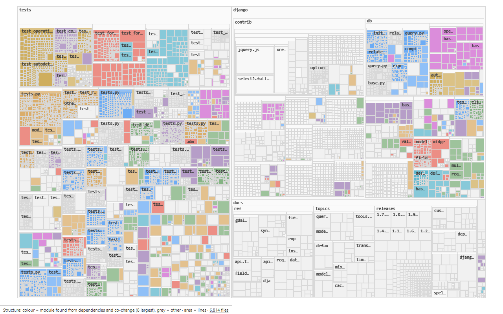
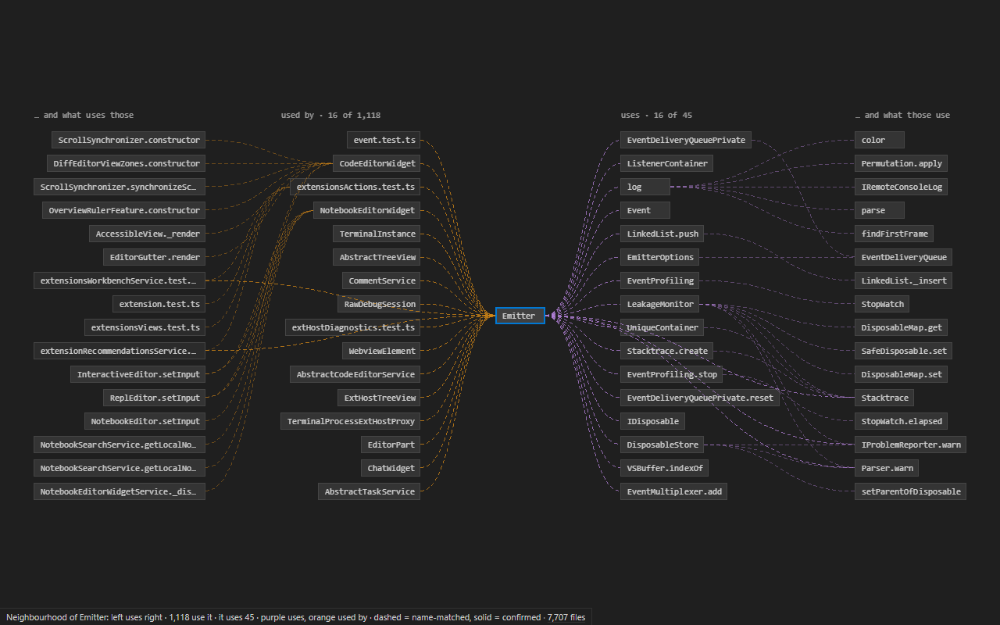

# Terrain

A map of your codebase inside VS Code: where everything is, what holds it up, what changes together, and what your branch touches. Offline, deterministic, fast on large repositories.



## What it shows

**The map.** Every folder and file of the workspace as nested rectangles, sized by lines of code. Positions only change when files are added, moved or deleted, so you learn where things are. Zoom in and files open up into their classes and functions. Click to select, double-click to open. The map follows the editor: what you are looking at is marked on it.

**Lenses.** Number keys colour the map by one measure at a time. The legend always says what colour means.

| Key | Lens | Colour means |
| --- | --- | --- |
| 1 | Structure | Modules found from dependencies and co-change (8 largest coloured) |
| 2 | Load-bearing | How much of the code rests on it (PageRank over dependencies) |
| 3 | Churn | Commits in the last 90 days |
| 4 | Coupling | Files that change together with the selection; red where there is no code link (a hidden dependency) |
| 5 | Ownership | Top author by commits |
| 6 | Change | What this branch changed (strong) and what depends on it (light) |

**Neighbourhood** (N, Ctrl+Alt+N in the editor, or click a CodeLens). The selected function or file in the middle, what uses it on the left, what it uses on the right, two steps each. Reads left to right: "A uses B uses C".



**Path** (P, or Terrain: Find Path Between…). The shortest dependency chains between two things, up to three. Answers "why does this module end up importing that one?"

**Review** (Ctrl+Alt+R, or the status bar). On a branch, the files it changed (committed or not) ranked by how much depends on them: read these first. The map switches to the Change lens.

**Next to the code.** The Context view in the activity bar shows, for the symbol under the cursor: callers, callees, importers, tests that reach it, blast radius, churn, owner, and the files that change with it. CodeLens above functions: `12 callers · blast 48 · 3 tests`.

**Lists.** Terrain: Show Cycles (import cycles, with the edge that breaks the most of each), Show Dead-Code Candidates, Show Hidden Dependencies, Show Misplaced Files.

## How sure it is

Terrain reads code with tree-sitter and resolves names itself, so most edges are well-founded guesses. It says so: dashed lines are name-matched, solid lines are confirmed. For the symbol you are looking at, Terrain asks VS Code's own language server (the call hierarchy of whatever language extension you have installed) and turns confirmed calls solid and drops the guesses it contradicts. Dotted lines come from git history.

## Getting started

Open a folder and run **Terrain: Open Map** (Ctrl+Alt+M, Cmd+Alt+M on macOS). There is nothing to configure. The first index of a large repository takes seconds to a minute and the map fills in while it runs; after that it opens in under half a second and updates as you save. The walkthrough on the Welcome page shows the three things worth trying first.

## Keyboard (in the map)

| Key | Action |
| --- | --- |
| `/` | Search files and symbols |
| Enter | Open the selection in the editor |
| Arrow keys | Move to the neighbouring tile (map) or along edges (Neighbourhood) |
| `+` `-` `0` | Zoom in, out, fit |
| `1`–`6` | Lens |
| `M` `N` `P` | Map, Neighbourhood of the selection, Path from the pinned (or previous) node to the selection |
| `F` | Follow the editor on or off |
| Backspace | Back in selection history |
| `.` | Pin the selection (pinned nodes keep their edges drawn) |
| `?` | All keys |

## Settings

| Setting | Default | |
| --- | --- | --- |
| `terrain.exclude` | `[]` | Extra gitignore-style patterns to leave off the map (`vendor/`, `**/*.min.js`). `.gitignore` and `.ignore` are always honoured. |
| `terrain.map.capDataFiles` | `true` | Count data files (CSV, logs, datasets, large JSON) as at most 50 lines, so area keeps meaning lines of code. |
| `terrain.map.follow` | `true` | Follow the active editor on the map. |
| `terrain.history.enabled` | `true` | Read git history for churn, ownership and co-change. |
| `terrain.semanticEnrichment.enabled` | `true` | Confirm calls of the symbol in view with the language server. |
| `terrain.codeLens.enabled` | `true` | CodeLens above functions and classes (skipped in files over 5,000 lines). |
| `terrain.indexerPath` | | Use a different `terrain-indexer` binary. |

## Languages

Definitions, imports, calls and references for TypeScript, JavaScript (and TSX/JSX), Python, Go, Rust, Java, C, C++, C#, Kotlin, Ruby, PHP and Swift. Lua through its grammar's tags. Every other text file is on the map, and paths mentioned in Markdown, Dockerfiles and configuration files become edges.

## Speed

Measured on a 4-core laptop (i5-1135G7, 8 GB):

| | |
| --- | --- |
| Map visible when reopening an indexed repository | 42 ms (django) to 383 ms (linux kernel, 86,000 files) |
| Cold index, django (6,800 files) | 6.5 s |
| Update after saving a file | 23 ms |
| Neighbourhood of any symbol | p99 4.5 ms on django; 13 ms for vscode's busiest file |
| Full git history of vscode (126,385 commits) | 19 s once, then 0.5 s per new batch of commits |
| Pan and zoom on the linux kernel at file level | 58–60 fps |

## Privacy

Terrain runs locally. It sends nothing anywhere: no telemetry, no network calls. The index lives in VS Code's workspace storage.

## Building from source

Requires Rust (stable) and Node 24.

```
npm install
npm run build
cargo build --release --manifest-path indexer/Cargo.toml
code --extensionDevelopmentPath=extension <a folder to map>
```

Tests: `npm test`, `cargo test --manifest-path indexer/Cargo.toml --workspace`, `npm run test:integration -w extension` (a real VS Code), `node webview/test-visual/themes.mjs <folder>` (three themes), `node bench/run.mjs` (performance budgets). How it is built and why: [DECISIONS.md](DECISIONS.md); where it stands: [PROGRESS.md](PROGRESS.md).

## License

MIT
